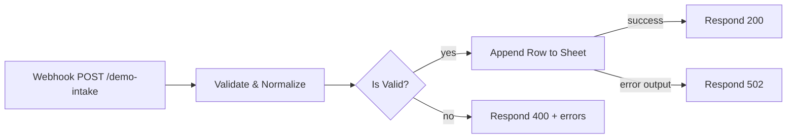
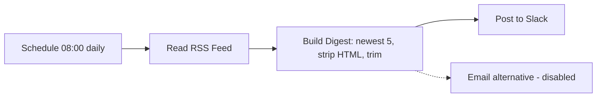
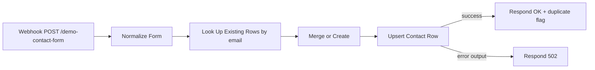

[English](README.md) | **日本語**

# n8n Automation Recipes

中小企業でよくある自動化作業のための、インポートしてすぐ使えるn8nワークフロー3本と、ワークフローのJSONをCIで検査するバリデーターです。

> **これはデモ用のプロジェクトです。** n8nの自動化をどう組み立てるかを示すために書いた、オリジナルのサンプルです。クライアントの案件ではなく、本番データでの実行もしていません。認証情報はプレースホルダーで、実在のアカウント、ID、キーは含んでいません。

作成: Tomohiro（日本・京都、UTC+9） - AI自動化デベロッパー | n8n・Python・API連携
Upwork: <https://www.upwork.com/freelancers/~0159af0451937c1a2a>

| # | ワークフロー | 見どころ |
|---|----------|---------------|
| 1 | [WebhookからGoogleスプレッドシートへ](workflows/01-webhook-to-google-sheets.json) | 入力チェック、データの整形、シートへの追記、適切なHTTPエラー応答 |
| 2 | [RSSの日次まとめをSlackへ](workflows/02-daily-rss-digest-to-slack.json) | 定時の取得、リトライ、要約、通知（メール版も同梱、無効化済み） |
| 3 | [重複チェック付きのフォーム受付](workflows/03-form-dedupe-crm-sheet.json) | 書き込み前の検索、メールアドレスをキーにしたupsert、CRM風の管理列 |

## インポート方法

1. n8nで **Workflows -> Import from File** を選び、`workflows/` 内のJSONファイルを1つ選びます。
2. Google Sheets / Slack / SMTP の各ノードを開き、自分の認証情報を選びます（インポート直後は `REPLACE_WITH_YOUR_CREDENTIAL_ID` というプレースホルダーです）。
3. `REPLACE_WITH_SPREADSHEET_ID`（シートのURLにある長いID）と、ワークフロー2では `REPLACE_WITH_CHANNEL_ID` を置き換えます。
4. 下の各セクションに書いた見出し行で、シートのタブを作ります。
5. 一度手動で実行してから、ワークフローを有効にします。

想定する環境: n8n 1.x、`executionOrder: v1`。使用しているノードのバージョン: Webhook 2、Code 2、IF 2、Google Sheets 4.5、Schedule Trigger 1.2、RSS Feed Read 1.1、Slack 2.3。お使いのn8nが古い場合は、どのノードを更新すべきかn8nが表示します。

---

## 1. WebhookからGoogleスプレッドシートへ



**シート:** タブ `Leads`、見出し行 `received_at | name | email | amount | source`

**入力**

```json
{ "name": "  Jane   Doe ", "email": "Jane.Doe@Example.com", "amount": "120.5", "source": "landing-page" }
```

**追記される行**

| received_at | name | email | amount | source |
|---|---|---|---|---|
| 2026-01-15T09:30:00.000Z | Jane Doe | jane.doe@example.com | 120.5 | landing-page |

**応答:** `200 {"status":"ok","email":"jane.doe@example.com"}`、`400 {"status":"error","errors":["email is missing or invalid"]}`

**エラー処理:** 不正な入力はシートに届かず、理由付きの `400` を返します。Sheetsノードは *continue (using error output)* に設定しているので、APIや権限のエラーが起きても、リクエストが止まったままにならず、呼び出し元にきちんと `502` を返します。

**試す:** `curl -X POST <your-test-webhook-url> -H "Content-Type: application/json" -d '{"name":"Jane Doe","email":"jane@example.com","amount":10}'`

## 2. RSSの日次まとめをSlackへ



**準備:** *Read RSS Feed* にフィードのURL（プレースホルダーは `https://example.com/feed.xml`）を設定し、Slackのチャンネルを選び、ワークフロー設定でタイムゾーンを指定します（デモでは `Asia/Tokyo`）。

**出力例（Slackのメッセージ）**

```
*Daily digest* (2 items)
1. <https://example.com/a|New release notes>
    Short plain-text summary of the first item...
2. <https://example.com/b|Another post>
    Short plain-text summary of the second item...
```

**エラー処理:** フィードの読み込みは2秒間隔で3回までリトライし、それでも失敗したら処理を続けます。フィードに届かなくても実行全体は止まらず、まとめのステップが「No new items in the feed today.」を投稿します。メールで受け取りたい場合は、*Email Alternative* ノードを有効にし、Slackノードを無効にします。

> まとめはルールベース（新しい順、本文を短く整形）です。AIモデルを呼ばないので、APIキーは不要です。

## 3. 重複チェック付きのフォーム受付



**シート:** タブ `Contacts`、見出し行 `email | name | company | last_message | first_seen | last_seen | submissions | status`

**入力**

```json
{ "email": "Sam@Example.com", "name": "Sam", "company": "Example Ltd", "message": "Please send a quote." }
```

**動作:** 小文字にしたメールアドレスを重複判定のキーにします。初回の送信では行を作成します（`submissions = 1`、`status = new`）。同じ人が再送信すると同じ行を更新し、`last_seen` と `last_message` を書き換え、`submissions` を1増やし、`first_seen` と `status` はそのまま残します。応答は `{"status":"ok","duplicate":true|false}` です。

**エラー処理:** メールアドレスがない・不正な場合はCodeノードがエラーを投げ、n8nがその実行を失敗として記録します（通知が必要なら、設定でError Workflowを指定してください）。検索ノードは *Always Output Data* をオンにしているので、シートが空でも、一致がなくても「新規作成」として進みます。書き込みに失敗した場合は `502` を返します。

---

## 検証とCI

`scripts/validate_workflows.py` はn8nを起動せずに実行でき、各ファイルについて次を確認します。

- n8nのエクスポート形式（`name`、`nodes`、`connections`）の正しいJSONであること
- 各ノードに `id`、`name`、`type`、`typeVersion`、`position`、`parameters` があり、名前とIDが重複していないこと
- 接続先が実在するノードを指し、トリガーが1つ以上あること
- 認証情報は `REPLACE_...` のプレースホルダーだけで、秘密情報らしき値が含まれていないこと

```bash
pip install pytest ruff
python scripts/validate_workflows.py workflows
ruff check scripts tests
pytest -q
```

GitHub Actions（`.github/workflows/validate.yml`）が、pushとプルリクエストのたびに同じ3つのコマンドを実行します。

## 制限事項

- ワークフローは構造（JSON、ノードの形式、接続）を検査しただけで、実際のGoogle、Slack、SMTPのアカウントでは実行していません。
- シートの列名はノードの対応付けに固定で書いています。変える場合は、シートとノードの両方で名前を変更してください。
- Webhookには認証を付けていません。外部に公開する前に、ヘッダー認証か推測されにくいパスを追加してください。

## ライセンス

[MIT](LICENSE)
