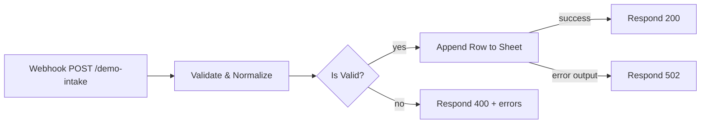
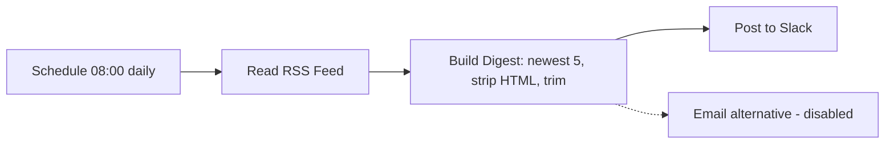
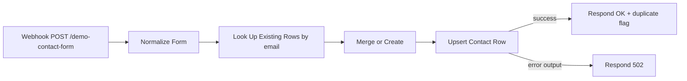

**English** | [日本語](README.ja.md)

# n8n Automation Recipes

Three importable n8n workflows for common small-business automation tasks, plus a validator that checks the workflow JSON in CI.

> **This is a demo project.** All workflows are original sample code written to show how I structure n8n automations. They are not client work, and they have not been run against production data. Credentials are placeholders; no real accounts, IDs or keys are included.

Built by Tomohiro (Kyoto, Japan, UTC+9) - AI Automation Developer | n8n, Python & API Integration.
Upwork: <https://www.upwork.com/freelancers/~0159af0451937c1a2a>

| # | Workflow | What it shows |
|---|----------|---------------|
| 1 | [Webhook to Google Sheets](workflows/01-webhook-to-google-sheets.json) | Input validation, data cleanup, append to a sheet, proper HTTP error responses |
| 2 | [Daily RSS digest to Slack](workflows/02-daily-rss-digest-to-slack.json) | Scheduled fetch, retry, summarize, notify (email alternative included, disabled) |
| 3 | [Form intake with duplicate check](workflows/03-form-dedupe-crm-sheet.json) | Lookup before write, upsert keyed on email, CRM-style tracking columns |

## How to import

1. In n8n choose **Workflows -> Import from File** and select one of the JSON files in `workflows/`.
2. Open each Google Sheets / Slack / SMTP node and select your own credential (the imported ones are `REPLACE_WITH_YOUR_CREDENTIAL_ID` placeholders).
3. Replace `REPLACE_WITH_SPREADSHEET_ID` (the long ID in the sheet URL) and, for workflow 2, `REPLACE_WITH_CHANNEL_ID`.
4. Create the sheet tab with the header row listed in each section below.
5. Run the workflow manually once, then activate it.

Tested layout target: n8n 1.x with `executionOrder: v1`. Node versions used: Webhook 2, Code 2, IF 2, Google Sheets 4.5, Schedule Trigger 1.2, RSS Feed Read 1.1, Slack 2.3. If your n8n version is older, n8n will tell you which node to update.

---

## 1. Webhook to Google Sheets



**Sheet:** tab `Leads`, header row `received_at | name | email | amount | source`.

**Input**

```json
{ "name": "  Jane   Doe ", "email": "Jane.Doe@Example.com", "amount": "120.5", "source": "landing-page" }
```

**Row appended**

| received_at | name | email | amount | source |
|---|---|---|---|---|
| 2026-01-15T09:30:00.000Z | Jane Doe | jane.doe@example.com | 120.5 | landing-page |

**Responses:** `200 {"status":"ok","email":"jane.doe@example.com"}`, `400 {"status":"error","errors":["email is missing or invalid"]}`.

**Error handling:** invalid input never reaches the sheet and gets a `400` with the reasons. The Sheets node uses *continue (using error output)*, so an API or permission failure returns a clean `502` to the caller instead of a hung request.

**Try it:** `curl -X POST <your-test-webhook-url> -H "Content-Type: application/json" -d '{"name":"Jane Doe","email":"jane@example.com","amount":10}'`

## 2. Daily RSS digest to Slack



**Setup:** set the feed URL in *Read RSS Feed* (placeholder `https://example.com/feed.xml`), pick the Slack channel, and set the workflow time zone in settings (the demo uses `Asia/Tokyo`).

**Output example (Slack message)**

```
*Daily digest* (2 items)
1. <https://example.com/a|New release notes>
    Short plain-text summary of the first item...
2. <https://example.com/b|Another post>
    Short plain-text summary of the second item...
```

**Error handling:** the feed read retries 3 times (2 s apart) and then continues, so an unreachable feed does not crash the run; the digest step then posts "No new items in the feed today." To use email instead, enable the *Email Alternative* node and disable the Slack node.

> The digest is rule-based (newest items, trimmed text). It does not call an AI model, so it needs no API key.

## 3. Form intake with duplicate check



**Sheet:** tab `Contacts`, header row `email | name | company | last_message | first_seen | last_seen | submissions | status`.

**Input**

```json
{ "email": "Sam@Example.com", "name": "Sam", "company": "Example Ltd", "message": "Please send a quote." }
```

**Behavior:** the lowercase email is the dedupe key. A first submission creates a row (`submissions = 1`, `status = new`). A repeat submission updates the same row: `last_seen` and `last_message` change, `submissions` is incremented, and `first_seen` and `status` are preserved. The response reports `{"status":"ok","duplicate":true|false}`.

**Error handling:** a missing/invalid email makes the Code node throw, so n8n marks the execution as failed (attach an Error Workflow in settings to be alerted). The lookup node has *Always Output Data* on, so an empty sheet or no match still proceeds as "create". Write failures return `502`.

---

## Validation and CI

`scripts/validate_workflows.py` runs without an n8n instance and checks that each file:

- is valid JSON in n8n's export format (`name`, `nodes`, `connections`);
- has nodes with `id`, `name`, `type`, `typeVersion`, `position`, `parameters`, unique names and ids;
- has connections that point to existing nodes, and at least one trigger;
- contains only `REPLACE_...` credential placeholders and no secret-looking values.

```bash
pip install pytest ruff
python scripts/validate_workflows.py workflows
ruff check scripts tests
pytest -q
```

GitHub Actions (`.github/workflows/validate.yml`) runs the same three commands on every push and pull request.

## Limitations

- These workflows were checked structurally (JSON, node format, connections) but not executed against live Google, Slack or SMTP accounts.
- Sheet column names are fixed in the node mappings; rename them in both the sheet and the node.
- No authentication is added to the webhooks. Add header auth or a secret path before exposing them.

## License

[MIT](LICENSE)
